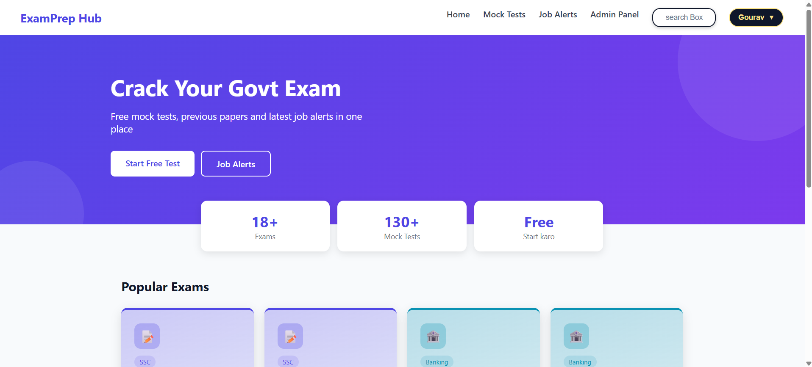

# ExamPrep Hub

A full-stack mock test platform for govt exam preparation (SSC, Banking, Railway, State Govt). Students practice timed mock tests, get instant results and analytics, and unlock premium exams with a monthly membership. Admins manage everything from a separate panel.

## Features

**Student**
- Signup and login with JWT authentication
- Mock tests with a circular timer, question palette, mark for review and auto-submit
- Server-side scoring, result page with donut chart and section-wise performance
- Result history, leaderboard with rank, and a Your Progress dashboard
- Python-powered analytics: percentile, section-wise comparison and score trend charts
- Premium exams with a Rs 200 monthly membership (Razorpay, test mode) and a confirmation email
- Latest govt job alerts, profile page with change password

**Admin**
- Role-based admin panel: manage exams, questions, students and job alerts
- Make or remove premium access for a student

## Tech Stack

| Layer | Technology |
|---|---|
| Frontend | React (Vite), React Router, Axios, CSS |
| Backend | Node.js, Express |
| Database | MongoDB with Mongoose |
| Analytics service | Python, FastAPI, Pandas, NumPy, Matplotlib, Seaborn |
| Auth and security | JWT, bcrypt, role-based access, signature-verified payments |
| Payments and email | Razorpay, Nodemailer (Gmail) |

## Architecture

```
React (5173)  ->  Node + Express API (5000)  ->  MongoDB
                        |
                        v  (shared secret key)
                  Python FastAPI analytics (8000)  ->  MongoDB
```

## Project Structure

```
Quiz/        React frontend (pages, components, hooks, services)
server/      Express API (models, controllers, routes, middleware, utils)
analytics/   FastAPI analytics microservice
```

## Run Locally

Requirements: Node.js 18+, Python 3.10+, MongoDB running locally.

**1. Backend**
```bash
cd server
npm install
# create server/.env (see Environment Variables below)
npm run dev
```

**2. Frontend**
```bash
cd Quiz
npm install
npm run dev
```

**3. Analytics service**
```bash
cd analytics
python -m venv venv
venv\Scripts\python -m pip install -r requirements.txt
venv\Scripts\python -m uvicorn app:app --port 8000
```

**4. Create an admin and sample data**
```bash
cd server
node createAdmin.js "Your Name" you@example.com "YourPassword"
node seed.js
node seedQuestions.js
```

## Environment Variables

`server/.env`
```
PORT=5000
MONGO_URI=mongodb://127.0.0.1:27017/examprep
JWT_SECRET=your-long-random-secret
ANALYTICS_URL=http://127.0.0.1:8000
ANALYTICS_KEY=shared-secret-with-analytics
RAZORPAY_KEY_ID=rzp_test_xxxxx
RAZORPAY_KEY_SECRET=your-razorpay-test-secret
EMAIL_USER=your-sender@gmail.com
EMAIL_APP_PASSWORD=your-gmail-app-password
```

`analytics/.env`
```
MONGO_URI=mongodb://127.0.0.1:27017/examprep
ANALYTICS_KEY=shared-secret-with-server
```

Never commit real keys. Razorpay runs in test mode, so no real money is charged.

## Security Notes

- Passwords are hashed with bcrypt, and sessions use signed JWTs
- Admin role cannot be set through signup. Admin routes are protected on the server by middleware, not only in the UI
- Correct answers are never sent to the browser. Scores are calculated on the server
- Payment amount is fixed on the server, and the Razorpay signature is verified (HMAC-SHA256) before premium is granted
- The analytics service only accepts requests with a shared secret key

## Screenshots

| Home | Test Page |
|---|---|
|  |  |

| Result | Admin Panel |
|---|---|
|  |  |

## Roadmap

- Deploy (MongoDB Atlas, Render, static hosting)
- Email verification and forgot password
- Razorpay live mode and webhooks
- Pagination, rate limiting and automated tests

## Author

Gourav Choudhary | [GitHub](https://github.com/Gourav589) | [LinkedIn](https://www.linkedin.com/in/gourav-choudhary-0001gc)